# ClockIn

> **Lock funds. Do the work. Get paid and reviewed — atomically.**

ClockIn is a mobile-first **P2P Work Contract & Escrow Protocol** built natively for the Solana Mobile Stack. It enables freelancers, gig workers, and clients to negotiate agreements, lock payment safely inside Program Derived Address (PDA) escrow vaults in **SOL, USDC, or $SKR**, communicate via **end-to-end encrypted contract chat**, and release payment in the same transaction that records the worker's rating on-chain. It runs on **Solana Devnet**; review notes and deliverables are stored through Irys's Devnet node.

**Demo video:** https://youtu.be/23zOQ4CJjik · **Install (Android, Devnet):** [latest release](https://github.com/adewuyito/ClockIn/releases/latest) · **Verify the claims:** [`docs/VERIFICATION.md`](docs/VERIFICATION.md)

---

## What works today, and what does not

Everything in this README runs on **Solana Devnet**. The full list, with where to check each item, is in [`docs/STATUS.md`](docs/STATUS.md).

| Works today | Built but switched off | Planned, not built |
|---|---|---|
| Escrow in SOL, USDC and Devnet test $SKR: create and fund, accept, release and review, cancel | Juror arbitration (new cases refused on-chain with `JURY_ENABLED = false`; hidden in the app) | Juror selection from $SKR Guardian stakers |
| Disputes settled by the two parties, including a 50/50 split both must agree to | | Protocol fee (none exists; settlements move the full amount) |
| On-chain worker profiles, ratings and lookup | | Milestone payments (a contract has one amount and one release) |
| End-to-end encrypted chat and deliverables | | Mainnet deployment |
| Seeker badge from real $SKR Guardian stake (read-only) | | Security audit and multisig upgrade authority |
| Wallet signing through Mobile Wallet Adapter, offline cache, QR scanning | | dApp Store listing, permanent storage, verified build |

---

## The Problem & The ClockIn Solution

| Traditional Gig Economy | ClockIn Escrow Protocol |
|---|---|
| **High Middleman Fees**: Platforms take 10%–20% cuts on every invoice. | **Zero Platform Cut**: Direct peer-to-peer on Solana. Only standard network transaction fees apply. |
| **Payment Risk**: Freelancers risk non-payment; employers risk paying for incomplete work. | **Atomic Escrow PDAs**: Client locks SOL, USDC, or $SKR in a programmatic vault; funds can only be released upon completion or refunded on cancellation. |
| **Walled-Garden Reputation**: Upwork or Fiverr ratings are locked inside closed corporate silos and reset to zero on new platforms. | **Portable, Public Reputation**: Ratings are recorded in Solana Anchor PDAs tied to the worker's wallet. Written review notes are stored through **Irys** (its Devnet node today, which is not permanent). |
| **Unencrypted / Monitored Chat**: Private messages and deliverable drafts are stored in plain text on centralized servers. | **End-to-End Encrypted Chat & Deliverables**: Messages and work files are encrypted using **X25519 DH key agreement + AES-256-GCM**; only contract parties hold the keys. |
| **Unilateral Dispute Arbitrariness**: Platforms resolve disputes arbitrarily or one side can drain escrowed funds unilaterally. | **Bilateral Dispute Settlement**: 50/50 splits require mutual agreement via `SplitProposal` PDAs (one proposes, the counterparty accepts). Neither party can force a split alone. |
| **Custodial Key Exposure**: Apps require custody of API keys, seed phrases, or private keys. | **Zero Key Custody**: 100% Mobile Wallet Adapter (MWA) v2.0 authorization. Private keys never touch ClockIn. |

---

## Core Protocol Mechanics

```mermaid
sequenceDiagram
    autonumber
    actor Employer as Employer (Client)
    participant Chat as E2EE Contract Chat (X25519 + AES-GCM)
    participant Vault as Vault PDA [b"vault", id]
    participant Escrow as Escrow PDA [b"escrow", id]
    participant Program as ClockIn Anchor Program
    actor Worker as Worker (Freelancer)
    participant Profile as WorkerProfile PDA
    participant Review as Review PDA
    participant Arweave as Irys storage (Devnet node)

    Note over Employer,Worker: 1. Agreement & Multi-Currency Funding
    Employer->Program: create_and_fund (SOL) / create_and_fund_token (USDC / $SKR)
    Program->Escrow: Initialize state (status = Funded)
    Program->Vault: Lock SOL, USDC, or $SKR into programmatic vault

    Note over Employer,Worker: 2. Acceptance, E2EE Chat & Encrypted Delivery
    Worker->Program: accept_contract(contract_id)
    Program->Escrow: Transition status -> InProgress
    Employer<<->>Worker: 1-on-1 encrypted chat with live contract milestone markers
    Worker->Arweave: Inscribe AES-256-GCM encrypted work with wrapped key & SHA-256 hash
    Worker->Employer: Deliverable submitted for verification

    Note over Employer,Worker: 3. Dual-Layer Atomic Settlement & Reputation
    Employer->Employer: Decrypt deliverable with attested X25519 key & verify hash
    Employer->Arweave: Inscribe qualitative review note & rating breakdown via Irys
    Arweave-->>Employer: Return storage receipt (Irys Devnet node)
    Employer->Program: release_and_review (SOL) / release_and_review_token (USDC / $SKR)
    Program->Vault: Transfer locked funds directly to Worker (closes token ATA & refunds rent)
    Program->Review: Create immutable Review PDA on Solana
    Program->Profile: Increment total_jobs & rating_sum
    Program->Escrow: Transition status -> Completed (terminal state&#59; chat & actions locked)
```



### Protocol Instructions (20 Anchor Instructions)

1. **Worker Registration & Profile**:
   - **`register_worker`**: Initializes the worker's on-chain `WorkerProfile` PDA with 0 completed jobs and 0 rating sum.
2. **Native SOL Escrow**:
   - **`create_contract` / `fund_contract` / `create_and_fund`**: Creates `EscrowContract` PDA and deposits SOL into programmatic `Vault` PDA.
   - **`accept_contract`**: Worker reviews terms and commits to the agreement (`status: InProgress`).
   - **`release_and_review`**: **Atomic SOL settlement**. Releases vault SOL to the worker, creates an immutable `Review` PDA, increments `WorkerProfile` aggregate score, and transitions contract to `Completed`.
   - **`cancel_contract`**: Reclaims locked vault SOL back to employer if the worker has not yet accepted.
3. **Multi-Currency SPL Token Escrow (USDC & $SKR)**:
   - **`create_and_fund_token`**: Initializes token contract, validates mint, and transfers SPL tokens directly into the Vault's Associated Token Account (ATA). Supports exact integer base-unit precision (6 decimals for USDC, 6 for $SKR).
   - **`release_and_review_token`**: **Atomic token settlement**. Transfers tokens from Vault ATA to Worker's ATA (with automatic idempotent ATA initialization), closes the Vault ATA reclaiming rent lamports back to the employer, mints `Review` PDA, and updates worker score.
   - **`cancel_token_contract`**: Reclaims locked tokens from Vault ATA back to employer ATA and closes the Vault ATA before worker acceptance.
4. **Bilateral Dispute Resolution & Split Proposals**:
   - **`raise_dispute`**: Either party can freeze the contract on-chain upon breach of terms (`status: Disputed`).
   - **`propose_split`**: Either party can open a `SplitProposal` PDA (`[b"split_proposal", contract_id]`) offering a 50/50 settlement. Proposer deposits rent.
   - **`cancel_split_proposal`**: The proposer can withdraw their open offer at any time and reclaim their rent lamports.
   - **`resolve_dispute` / `resolve_token_dispute`**: Settles a disputed contract:
     - `ReleaseToWorker`: Executable by employer only.
     - `RefundToEmployer`: Executable by worker only.
     - `Split5050`: Executable **only as acceptance of the counterparty's open split proposal**. Closes the proposal and refunds rent to proposer.
5. **Juror Arbitration (Guarded / Disabled)**:
   - Instructions `initialize_dispute_case`, `cast_juror_vote`, `execute_dispute_ruling`, and `execute_token_dispute_ruling` are implemented in Anchor but **explicitly disabled on-chain** (`JURY_ENABLED = false`) and feature-flagged in the app (`CLOCKIN_ENABLE_JURY = false`) until decentralized juror selection from active $SKR Guardian stakers is implemented.

---

## On-Chain Deployment (Solana Devnet)

| Parameter | Value |
|---|---|
| **Program ID** | [`FKicZKbepmiwj2rTnPrHNRBPAja3G5gSvi7KFkjHdEt9`](https://explorer.solana.com/address/FKicZKbepmiwj2rTnPrHNRBPAja3G5gSvi7KFkjHdEt9?cluster=devnet) |
| **Cluster** | Solana Devnet (`https://api.devnet.solana.com` / Helius Devnet RPC) |
| **ProgramData Account** | [`GmfYDR7SLX8ZRhErkKnD5gt8pTzzbuaH21WUi1ueCnRH`](https://explorer.solana.com/address/GmfYDR7SLX8ZRhErkKnD5gt8pTzzbuaH21WUi1ueCnRH?cluster=devnet) |
| **Upgrade Authority** | `GBZqhLZXAjBtfeVkVWMYWFN8DGmxskwKna3UEXGvfh8P` |
| **Last Deployed Slot** | `508848800` (Size: `565,296` bytes; deployed bytes match the tested build, SHA-256 `e35e388a…0ade`) |
| **Upgrade Tx** | [`YNtUAmHZBs7B4YvQMiM4i93ajTWb2JsCjYYHWGYrpH13SD4eHKuRjjsEntSvHnDrur5n34hBDpdcocrF5xz5XKe`](https://explorer.solana.com/tx/YNtUAmHZBs7B4YvQMiM4i93ajTWb2JsCjYYHWGYrpH13SD4eHKuRjjsEntSvHnDrur5n34hBDpdcocrF5xz5XKe?cluster=devnet) |
| **Devnet $SKR Token Mint** | [`Gd1eTEXDt1D9uyTqCrVTKtaumz7XmZKvfThVEX9856N9`](https://explorer.solana.com/address/Gd1eTEXDt1D9uyTqCrVTKtaumz7XmZKvfThVEX9856N9?cluster=devnet) |
| **Devnet USDC Token Mint** | [`4zMMC9srt5Ri5X14GAgXhaHii3GnPAEERYPJgZJDncDU`](https://explorer.solana.com/address/4zMMC9srt5Ri5X14GAgXhaHii3GnPAEERYPJgZJDncDU?cluster=devnet) |
| **Storage Gateway** | Irys Gateway (`https://gateway.irys.xyz/<arweave_tx_id>`) |
| **Anchor Integration Tests** | **39 test cases passing** (SOL + SPL tokens, bilateral splits, juror gate) |
| **Flutter Test Suite** | **176 automated unit, widget, Drift SQLite v13, key attestation, chat, and network-check tests passing** |
| **Firestore Security Tests** | **33 security rule emulator tests passing** (E2EE channel access restriction) |
| **Sample Escrow Contract** | [`ctr-mu4o1bhi`](https://explorer.solana.com/tx/2tvjD8XQezFBbzQXyD2VtR5vzae2ynLdCs6XLb4hAkyEqRbFGr5PexYtNPoi8xSojktbbLA9rSmdib7DUNSyZ2TT?cluster=devnet) (Status: `Completed`, 5★ review) |

See [`program/README.md`](program/README.md) for how to build and test the program, and [`program/DEPLOYED.md`](program/DEPLOYED.md) for complete deployment records, verification commands, and live transaction logs.

**Verifying these numbers.** [`docs/VERIFICATION.md`](docs/VERIFICATION.md) pins the commit, lists the commands to reproduce all 248 tests (39 program, 176 app, 33 rules) and the bytecode comparison, and links the saved test output in [`docs/test-evidence/`](docs/test-evidence/).

---

## Mobile Architecture & Technology Stack

- **Flutter / Dart & Riverpod 2.0**: High-fidelity mobile UI with reactive streams, built to Google Stitch design specifications with custom animations and status-bar scroll tinting.
- **Solana Mobile Wallet Adapter (MWA v2.0)**: Zero key custody. Sessions, authorizations, and multi-instruction transactions are signed directly in installed wallet apps (Phantom, Solflare) via Android intents.
- **Multi-Currency Accounting & Live Pricing**:
  - Native SOL, USDC (6 decimals), and $SKR (6 decimals).
  - Exact integer base-unit arithmetic prevents floating-point rounding errors on sub-cent amounts.
  - **`SolPriceService`**: Real-time SOL-to-USD pricing feed via CoinGecko and Jupiter Price API with aggressive caching and offline fallback, providing live fiat estimations across all contract flows.
- **End-to-End Encrypted Contract Chat (`ContractChatService`)**:
  - Dedicated 1-on-1 communication channel for each escrow contract.
  - **`ContractChatCrypto`**: Ephemeral per-contract AES-256-GCM symmetric encryption derived via X25519 Diffie-Hellman key agreement from wallet-attested public keys.
  - Chronological in-stream contract milestone markers (Funded, Accepted, Delivered, Released, Disputed).
  - Terminal-state locking: chat becomes permanently read-only once contracts settle.
  - Backed by Firestore with offline persistence and strict security rules.
- **Encrypted Deliverables & Arweave / Irys Pipeline**:
  - Freelancers upload deliverables encrypted with AES-256-GCM.
  - Symmetric key is wrapped with the employer's attested X25519 public key.
  - Ciphertext and SHA-256 hash are uploaded through Irys (Devnet node today; permanent storage is planned for mainnet).
  - Employer automatically unwraps the key with their private key, verifying cryptographic integrity before releasing funds.
  - Gated deliverable actions (`acceptsDeliverableActions`) automatically close revision requests and uploads on terminal or disputed contracts.
- **Drift SQLite Cache (Schema v13)**:
  - 10 reactive tables: `WorkerProfiles`, `Reviews`, `DraftReviews`, `RecentLookups`, `EscrowContracts`, `DraftContracts`, `SeekerAttestations`, `DisputeCases`, `DeliverableSubmissions`, `UserEncryptionKeys`.
  - Idempotent SQLite `PRAGMA` introspection ensures safe, failure-proof database migrations.
  - Full offline draft authoring and recovery for contracts and reviews.
- **Seeker Guardian Stake & Hardware Detection**:
  - Non-custodial read-only client for Solana Mobile's official SKR Guardian staking program (`stake.solanamobile.com`).
  - Verifies 250+ $SKR stake on-chain via `SkrStakeReader` with 24-hour Drift offline caching.
  - Detects genuine Solana Seeker hardware to display the verified hardware emblem; includes an optically centered `Stake` button and responsive narrow-screen wrapping.
- **QR Code Viewfinder & Apple-Style Passes**:
  - Real-time camera viewfinder (`QrScannerSheet`) powered by `mobile_scanner` that parses raw base58 Solana addresses, Solana Pay URIs (`solana:<addr>?amount=...`), and deep links.
  - Apple-style rounded `ProfileQrSheet` and `ContractShareScreen` for frictionless in-person or video-call reputation verification.
- **Adaptive Android Branding & Tactile Feedback**:
  - Android adaptive launcher icons (vector foregrounds across all density buckets and `mipmap-anydpi-v26`).
  - Tactile `HapticFeedback` on selections and celebratory spring scale-up burst (`CelebrationBadge`) upon atomic settlement.

---

## Repo Layout

```
ClockIn/
├── program/                      # Solana Anchor smart contract
│   ├── programs/reputation/      # Rust program source (20 instructions, 6 accounts)
│   ├── tests/                    # Mocha/Chai test suite (39 integration test cases)
│   ├── scripts/                  # On-chain devnet lifecycle & seeding scripts
│   ├── DEPLOYED.md               # Detailed on-chain deployment log & verification
│   └── Anchor.toml               # Anchor workspace configuration
├── app/                          # Flutter Android mobile application
│   ├── lib/
│   │   ├── core/
│   │   │   ├── config/           # Feature flags (CLOCKIN_ENABLE_JURY, etc.)
│   │   │   ├── database/         # Drift SQLite cache v13 (10 tables, idempotent migrations)
│   │   │   ├── models/           # Contract, deliverable, review, & split proposal models
│   │   │   ├── providers/        # Riverpod 2.0 reactive streams & state management
│   │   │   ├── services/         # Contract chat (E2EE), Irys storage, SOL price service
│   │   │   ├── solana/           # MWA v2.0 client, Anchor account decoders, instructions
│   │   │   └── theme/            # Material 3 design tokens & styling
│   │   └── features/             # Contracts, chat, disputes, deliverables, profile, lookup
│   ├── test/                     # Unit, widget, Drift SQLite, crypto, and chat tests (176 tests)
│   └── android/                  # Native Android configuration & adaptive mipmap icons
├── firestore.rules               # Strict Firestore security rules for chat & notifications
├── firestore-tests/              # Firestore rules test suite (33 Mocha test cases)
├── design/                       # Icon concepts, SVG assets, and design system tokens
└── docs/                         # Technical Specifications & Documentation
    ├── ARCHITECTURE.md           # System architecture, trust model, & data flow
    ├── PITCH_DECK.md             # 10-slide hackathon & investor pitch deck
    ├── JUDGING_PLAN.md           # Judging criteria mapping & demo walkthrough script
    ├── ROADMAP.md                # Phase-by-phase implementation roadmap
    ├── PROGRAM_SPEC.md           # Smart contract account schemas & instruction specifications
    └── APP_SPEC.md               # Mobile screens, view states, & service layer
```

---

## Getting Started

### Prerequisites
- **Flutter SDK**: 3.29.x / Dart 3.7.x (via FVM)
- **Solana CLI**: 3.1.x / `solana-cli`
- **Anchor CLI**: 1.2.0
- **Node.js**: v18+ (for Anchor tests and Firestore rules tests)
- **Android Device or Emulator** with [Phantom](https://phantom.app/) or [Solflare](https://solflare.com/) installed.

### 1. Build and Test the Anchor Program
```bash
cd program
# Build SBF executable
cargo build-sbf --arch v1 --sbf-out-dir target/deploy

# Regenerate the IDL and run the 39-case TypeScript integration test suite
anchor idl build -o target/idl/reputation.json -t target/types/reputation.ts
anchor test --skip-build --validator legacy
```

### 2. Run the Flutter Mobile App
```bash
cd app
fvm flutter pub get

# Run the automated test suite (176 passing tests)
fvm flutter test

# Verify static analysis (0 issues)
fvm flutter analyze lib/ test/

# Run app on connected Android device
fvm flutter run -d <device_id>

# Or build the release APK directly
fvm flutter build apk --release --target-platform android-arm64
```

### 3. Test Firestore Security Rules
```bash
cd firestore-tests
npm install
npm test
```

### 4. Wallet Configuration (Crucial for Devnet Testing)
ClockIn is deployed on **Solana Devnet**. Ensure your mobile wallet is set to Devnet prior to connecting:
- **Phantom**: Settings (gear icon) → Developer Settings → Toggle "Testnet Mode" **ON** → Select **Solana Devnet**.
- **Solflare**: Settings (gear icon) → General → Change Network → Select **Devnet**.


## License
MIT
